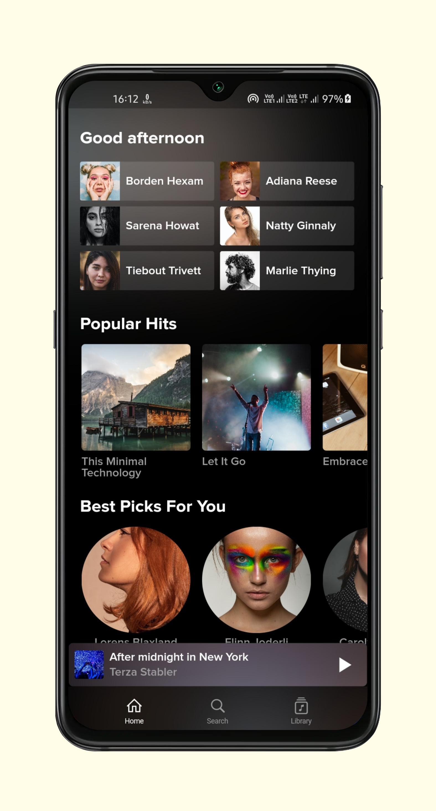
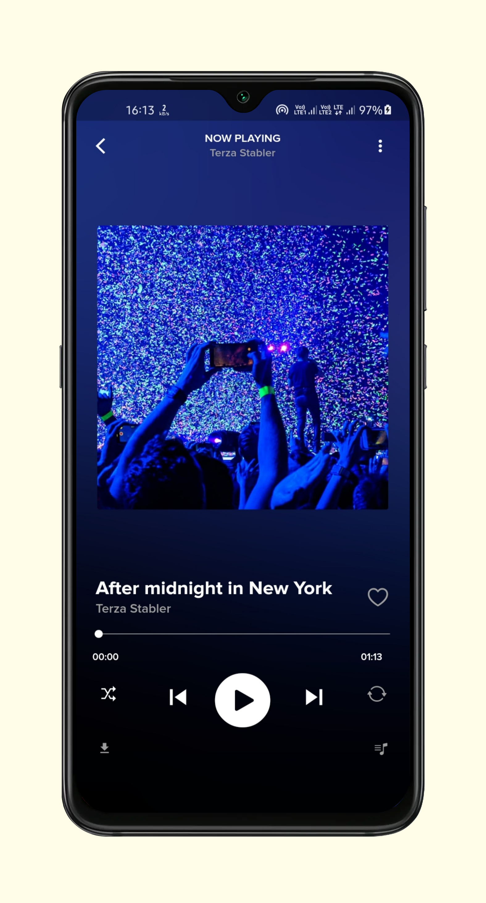
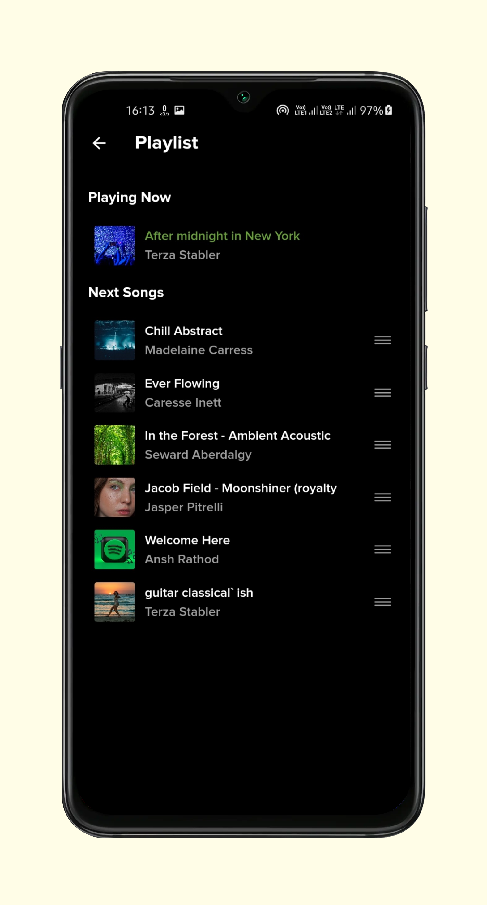
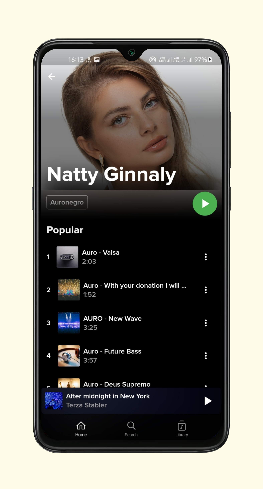
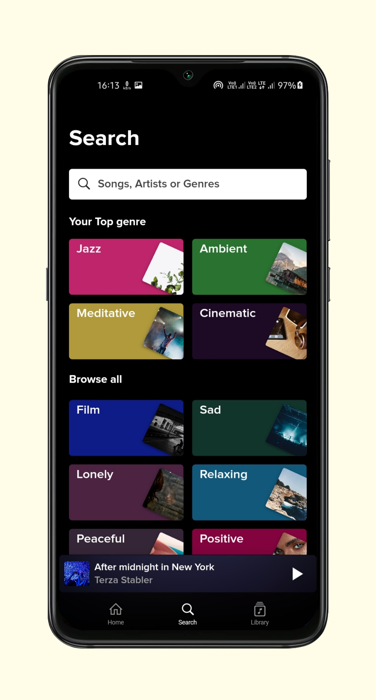
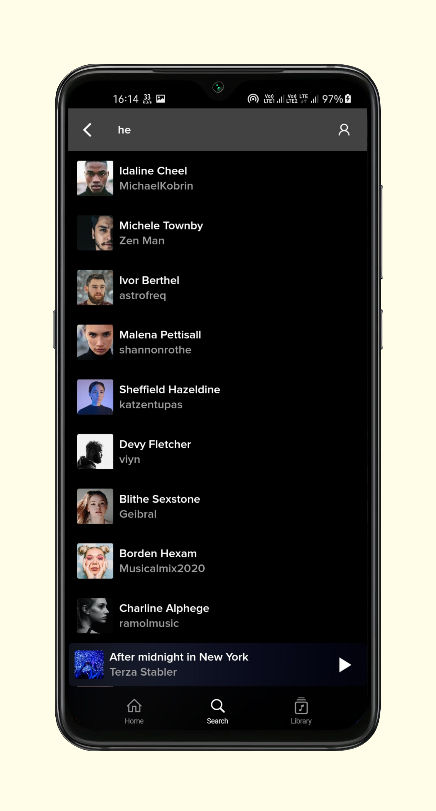
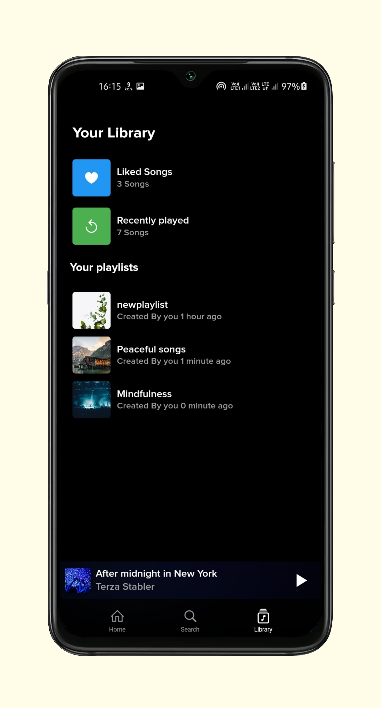
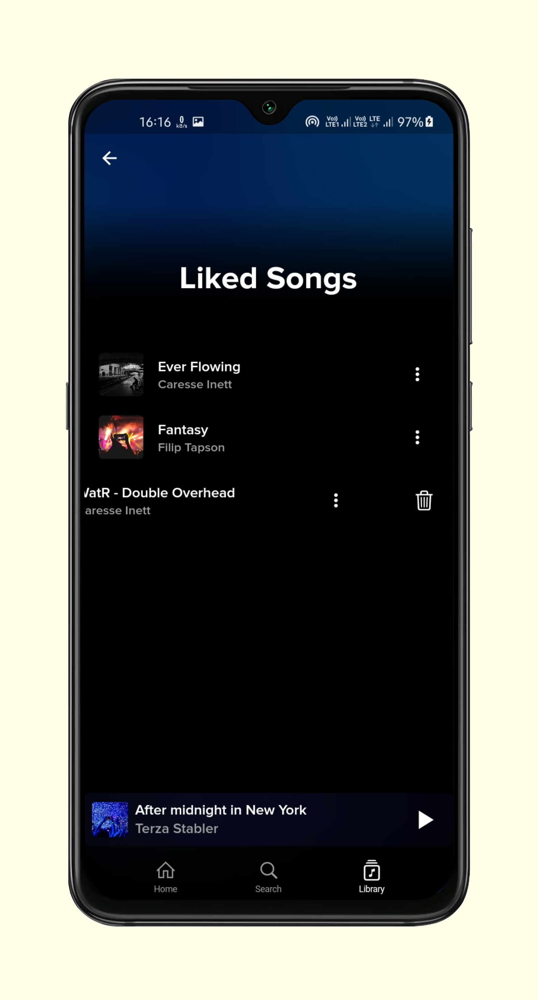
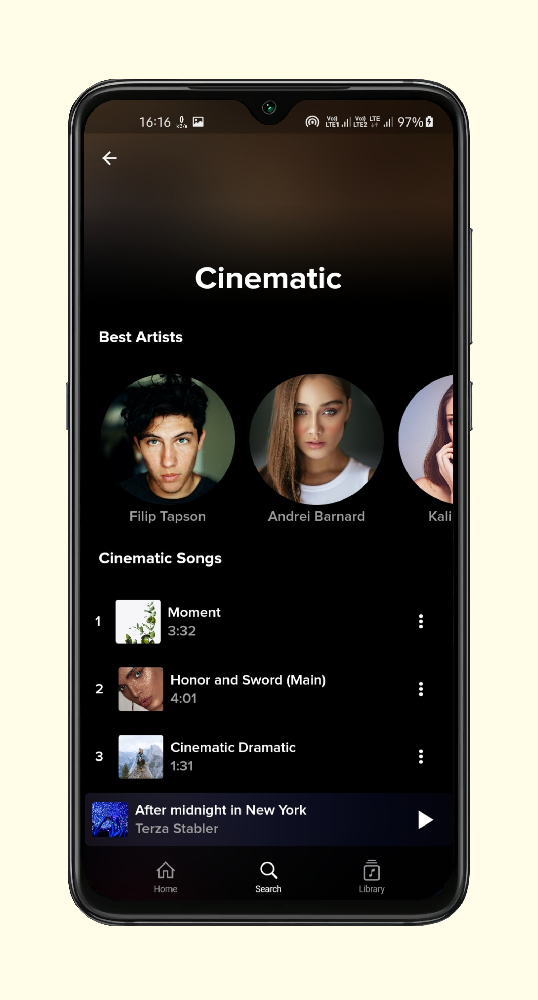

# Sangeet 🎵

<p align="center">
  
</p>

<p align="center">
  <strong>A feature-rich, high-performance Flutter music streaming & playback application inspired by Spotify.</strong>
</p>

<p align="center">
  
  
  
  
</p>

---

## 🌟 Overview

**Sangeet** is a full-featured, cross-platform music streaming player built with **Flutter** and **Dart**. Featuring a modern, fluid Spotify-style dark UI, Sangeet delivers high-quality audio playback, local media integration, synchronized lyrics, SponsorBlock segment skipping, and offline library management.

---

## ✨ Features

- **🎨 Modern Spotify-inspired UI**: Sleek dark-mode aesthetic with custom Proxima Nova typography, ambient progress indicators, smooth bottom navigation, and animated transitions.
- **🎧 High-Quality Audio Streaming**: Integrated stream resolvers supporting online music catalogs and direct stream resolution.
- **🎤 Synchronized Lyrics**: Multi-provider live lyrics parser (LRCLib, Musixmatch, Paxsenix, SimpMusic, TTML, Enhanced LRC) supporting line-by-line synced lyrics.
- **⏩ SponsorBlock Integration**: Automatically skip non-music segments, intros, and sponsor promos.
- **📚 Local Library & Hive Offline DB**: Fast local storage for Liked Songs, Playlists, Recently Played tracks, and Search History via Hive DB.
- **🔀 Queue & Reorderable Playlist**: Real-time queue management with drag-and-drop song reordering.
- **🔍 Advanced Search**: Instant search for songs, artists, albums, and playlists with recent search history memory.
- **🔔 Background Audio & Notification Controls**: Full background playback with lock screen media controls.
- **📱 Local Media Playback**: Supports scanning and playing audio files stored on your local device.

---

## 📱 Screenshots

<p align="center">
  
  
  
</p>

<p align="center">
  
  
  
</p>

<p align="center">
  
  
  
</p>

---

## 🛠️ Tech Stack & Architecture

- **Framework**: [Flutter](https://flutter.dev) (Dart `>=3.0.0 <4.0.0`)
- **State Management**: [flutter_bloc](https://pub.dev/packages/flutter_bloc) & [provider](https://pub.dev/packages/provider)
- **Audio Engine**: [assets_audio_player](https://pub.dev/packages/assets_audio_player)
- **Local Storage**: [hive_flutter](https://pub.dev/packages/hive_flutter)
- **Networking**: [dio](https://pub.dev/packages/dio) & [http](https://pub.dev/packages/http)
- **Image Caching**: [cached_network_image](https://pub.dev/packages/cached_network_image)

---

## 📂 Project Structure

```
lib/
├── api/             # API Clients (YouTube Music, Sunoh, Lyrics Providers, SponsorBlock)
├── audio/           # Stream Resolvers & Audio Refresher Logic
├── config/          # Environment Configuration
├── controllers/     # Main Application Controller & Audio State
├── data/            # Data Models (Lyrics, Streams, DTOs)
├── models/          # Core Domain Models (Song, Artist, User, Category)
├── repositories/    # Data Repositories (Home, Search, Genre, Artist)
├── screens/         # UI Screens (Home, Player, Library, Search, Playlist, Artist)
└── utils/           # Reusable UI Widgets, Custom Player Controls, Animations
```

---

## 🚀 Getting Started

### Prerequisites

- [Flutter SDK](https://flutter.dev/docs/get-started/install) (v3.0.0 or higher)
- [Git](https://git-scm.com/)

---

## 🤝 Contributing

Contributions, issues, and feature requests are welcome! Feel free to check the issues page or submit a pull request.

---

## 📄 License

This project is open source and available under the [MIT License](LICENSE).
